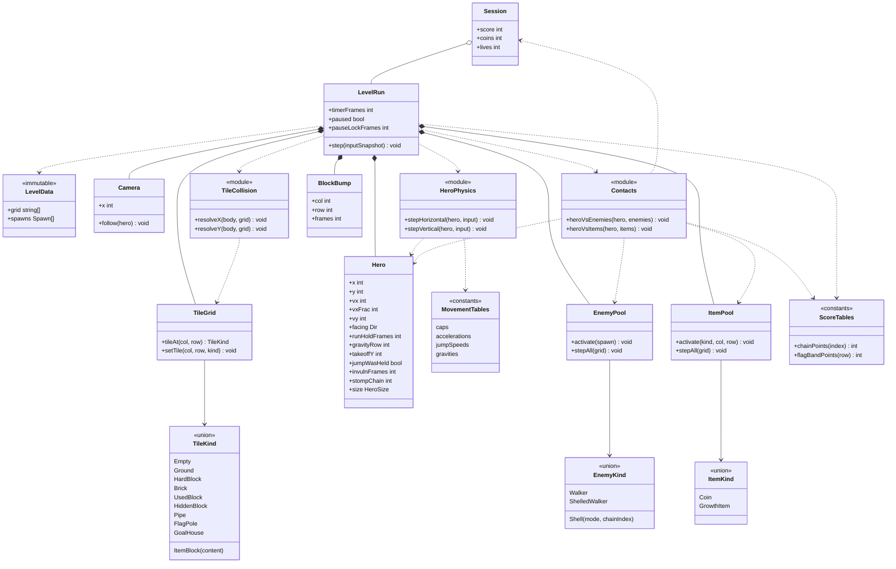

# Class diagram — gameplay — domain model

> **Source specs**: [GDD](../../../design/game-design-document.md) §4–§8
> **Related ADRs**: ADR-0002, ADR-0006

## Context

The main domain types of the vertical slice and their relations. Rendering, audio and storage
are not shown (ports, see `../system/03-component.md`). Units of the numeric fields: GDD §4.

## Diagram

## Notes

- All positions and speeds are fixed-point integers (GDD §4); no float in the domain.
- `Session` outlives a level: score, coins and lives survive a death and the next level (GDD §8,
  §9). A new `LevelRun` is built from `LevelData` for each attempt.
- `TileKind`, `EnemyKind` and `ItemKind` are discriminated unions with behaviour tables: a new
  tile, enemy or item is a new entry, not a new branch in the loop (open/closed).
- Pools are preallocated (no allocation in the loop). The stomp chain counter lives on the hero
  (reset on landing); each kicked shell keeps its own `chainIndex`.
- `BlockBump` is the short-lived record that lets a bumped block hurt the enemy standing on it.
- `LevelRun` calls the three stateless modules (`HeroPhysics`, `TileCollision`, `Contacts`) in the order of [06](06-sequence-tick.md); `Contacts` reads the hero and the pools and uses `ScoreTables` for stomp chains and updates `Session` (points, lives, coins); `LevelRun` uses `ScoreTables` for the flag bands ([12](12-sequence-flag-tally.md)).
- Meta types (scenes, save, bindings, catalogue) are in [15](../meta/15-class-meta.md).
- `RandomSource` (seeded) is omitted: the slice has no random rule (YAGNI).
- The flag sequence (slide, tally) is a `LevelRun` phase, see `05-state-hero.md`.
