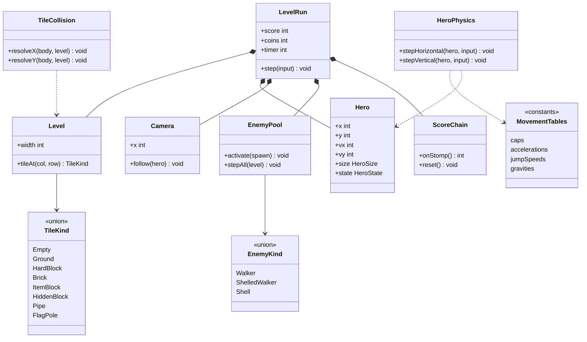

# Class diagram — gameplay — domain model

> **Source specs**: [GDD](../../../design/game-design-document.md) §4–§8
> **Related ADRs**: ADR-0002, ADR-0006

## Context

The main domain types of the vertical slice and their relations. Rendering, audio and storage
are not shown (ports, see `../system/03-component.md`).

## Diagram

## Notes

- All positions and speeds are fixed-point integers (GDD §4); no float in the domain.
- `TileKind` and `EnemyKind` are discriminated unions with behaviour tables: a new enemy or tile
  is a new entry, not a new branch in the loop (open/closed).
- `EnemyPool` is preallocated (no allocation in the loop).
- `RandomSource` (seeded) is omitted: the slice has no random rule yet (YAGNI).
