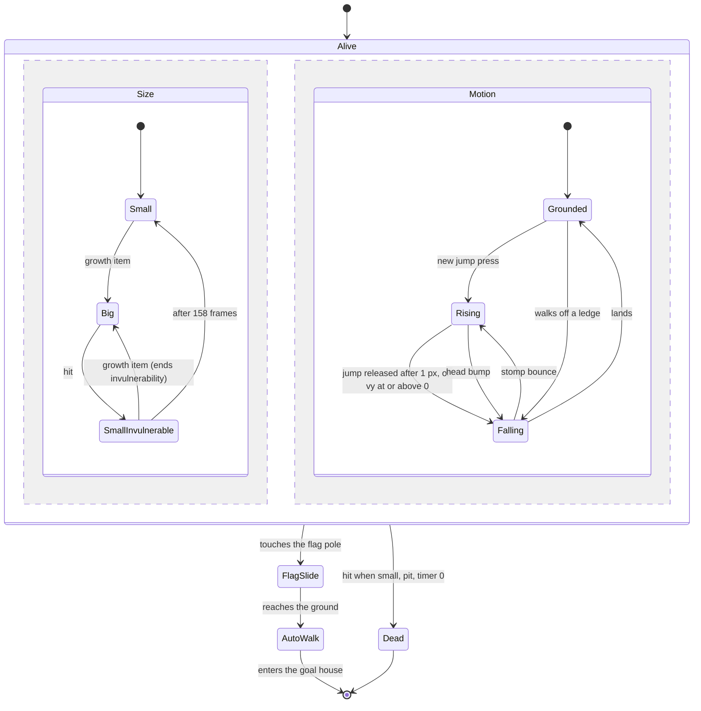

# State machine diagram — gameplay — hero

> **Source specs**: [GDD](../../../design/game-design-document.md) §4.2, §4.3
> **Related ADRs**: ADR-0002

## Context

The hero's life cycle at the top level, then two orthogonal regions while alive: size (power-up
state) and motion. The motion values of each state are the GDD §4 tables.

## Diagram

## Notes

- `Rising` uses the "held" gravity of the take-off row, `Falling` the "released" one (GDD §4.2);
  the pair chosen at take-off is kept until the next jump, even across a stomp bounce.
- `Grounded` covers walk, run and skid; they are speed ranges, not separate states (GDD §4.1).
- A hit during `SmallInvulnerable` is ignored; a growth item picked up then makes the hero `Big`
  and ends the invulnerability.
- Shooter size is out of the slice (GDD §4.3).
