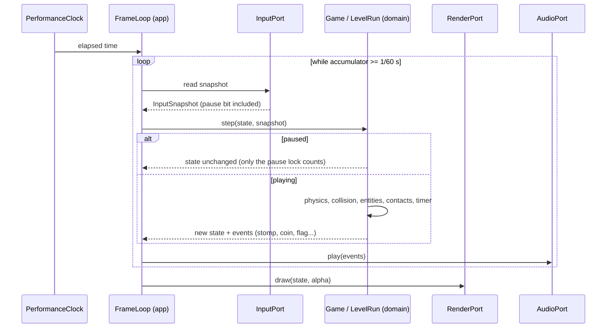

# Sequence diagram — gameplay — one fixed step of a level (UC1)

> **Source specs**: [GDD](../../../design/game-design-document.md) §5, §8, §9, §12; [use-case specs](../../use-case-specifications.md) UC1, UC2
> **Related ADRs**: ADR-0005, ADR-0006

## Context

How the frame loop drives one 60 Hz simulation step while a level is played, including the pause
branch. The domain never reads input or the clock itself.

## Diagram

## Notes

- Fixed timestep with an accumulator [gen] (CLAUDE.md); events are plain data returned by `step`,
  the app forwards them to `AudioPort` (the domain never calls the adapter).
- Auto-pause (focus lost, page hidden) is detected by the input adapter and delivered as a pause
  bit in the snapshot, so it is replayed like any input (GDD §9).
- The flag sequence and the tally are phases of the same `step` (no separate loop).
