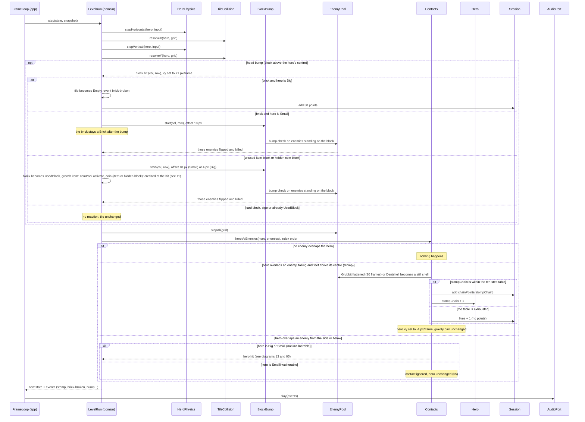

# Sequence diagram — gameplay — stomp and block hit (UC1)

> **Source specs**: [GDD](../../../design/game-design-document.md) §4.2, §5, §6, §8; [use-case specs](../../use-case-specifications.md) UC1 steps 3–4, 4d
> **Related ADRs**: ADR-0002, ADR-0005, ADR-0006

## Context

What happens inside one `step` when the hero meets an enemy or a block. It zooms into the
"physics, collision, entities, contacts" box of [06](06-sequence-tick.md). Everything shown runs
in the domain; the only outgoing data is the list of events the app forwards to `AudioPort`.

## Diagram

## Notes

- Tags. Head bump speed +1 px/frame, bump offsets 4 / 18 px, stomp bounce −4 px/frame, chain
  points and the +1 life at the chain's end: **[src]** (GDD §5, §4.2, §8). Stomp definition,
  contact test every frame, index-order resolution, 30-frame flattening, 50 points per brick:
  **[gen]** (GDD §5, §6, §8); brick points are unverified (OQ3).
- Hidden coin block (GDD §7, §10, [gen]): hit from below it behaves like a coin item block and becomes `UsedBlock`.
- Axis-separated movement (X then resolve, Y then resolve) is why `TileCollision` is called
  twice (GDD §5); the 4 px corner tolerance [gen] lives inside `resolveY`.
- Stomping a kicked shell stops it (GDD §6); not redrawn. A kicked shell reuses the same chain table (GDD §8, [gen]); its contacts are not redrawn.
- `stompChain` lives on the hero and resets on landing (04). Pools are preallocated: `activate`
  and the flattening reuse slots, nothing is allocated in the step.
- The domain never calls `AudioPort`: events are returned and forwarded by the app (ADR-0006).
