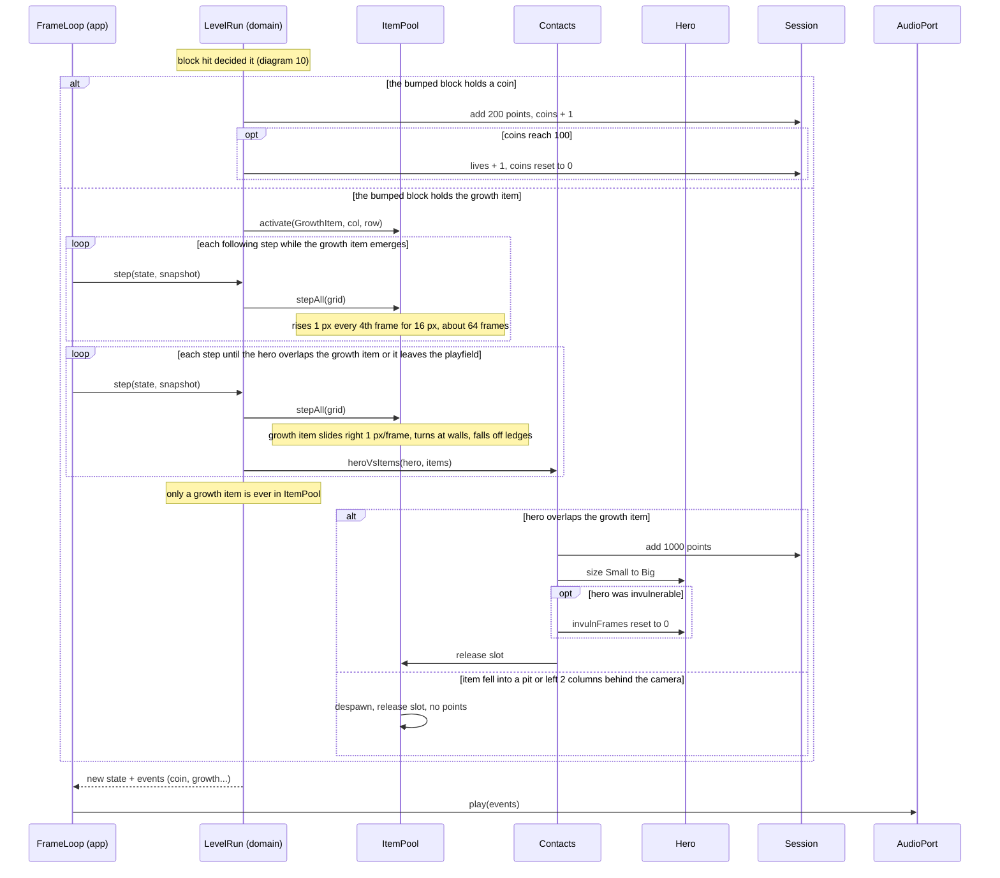

# Sequence diagram — gameplay — item emerges and is collected (UC1)

> **Source specs**: [GDD](../../../design/game-design-document.md) §4.3, §8; [use-case specs](../../use-case-specifications.md) UC1 steps 4, 4c, 4d
> **Related ADRs**: ADR-0005, ADR-0006

## Context

From the block hit that releases an item (see [10](10-sequence-collisions.md)) to the moment the
hero collects it: coin or growth item. All steps are 60 Hz `step` phases of the same `LevelRun`.

## Diagram

## Notes

- Tags. Emergence timing (1 px every 4th frame for 16 px) and the +1 life at 100 coins:
  **[src]** (GDD §8). Coin 200 and growth item 1000 points: **[gen]**, unverified (OQ3). Growth
  item ending invulnerability: **[gen]** (GDD §4.3).
- A coin from a block is scored at the hit and never enters `ItemPool`: the GDD level has coin blocks only, no loose coin (GDD §7, §10). `ItemKind.Coin` of 04 would be used by a later level with loose coins.
- An already Big hero collecting a growth item gets the points and no size change (GDD §4.3: the
  next size is the shooter item, out of the slice).
- Items are `ItemKind` entries (04): a new item is a new row of the behaviour table, not a new
  branch here. The slot is returned to the pool, never freed.
- The domain never calls `AudioPort`: the app forwards the returned events (ADR-0006).
