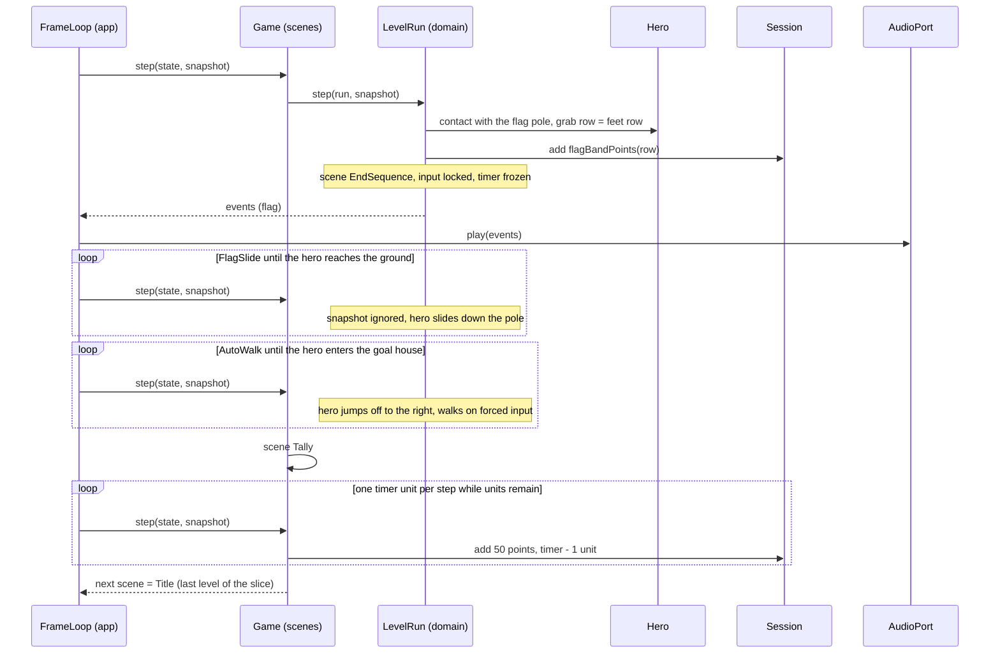

# Sequence diagram — gameplay — flag, end sequence and tally (UC1)

> **Source specs**: [GDD](../../../design/game-design-document.md) §8, §9; [use-case specs](../../use-case-specifications.md) UC1 steps 5–7
> **Related ADRs**: ADR-0005, ADR-0006

## Context

The last phase of a level: from the contact with the flag pole to the return to the title. It is
a sequence of `LevelRun` phases driven by successive `step` calls, with input ignored (GDD §9).
The scenes are those of [02](../system/02-state-game-flow.md), the hero states those of
[05](05-state-hero.md).

## Diagram

## Notes

- Tags. Five flag bands: **[src]**; their mapping to our tile rows 2–9: **[int]** (GDD §8, Q8);
  50 points per remaining timer unit: **[gen]**, unverified (OQ3); the hero's jump-off and walk
  to the goal house: **[src]** (GDD §9).
- Input lock and frozen timer are rules of the `EndSequence` scene, not of the adapter: the
  snapshot is still read every step, which keeps the replay script uniform (ADR-0005).
- The tally pace (one unit per step versus several) is not set by the GDD; the loop draws the
  simplest reading and the pace is a tuning constant at the first code brick **[gen]**.
- After the last level of the slice the scene goes to `Title`; with more levels it would go to
  `LevelIntro` (02).
- The domain never calls `AudioPort` or `RenderPort`; the app forwards events and draws once per
  frame, as in 06.
