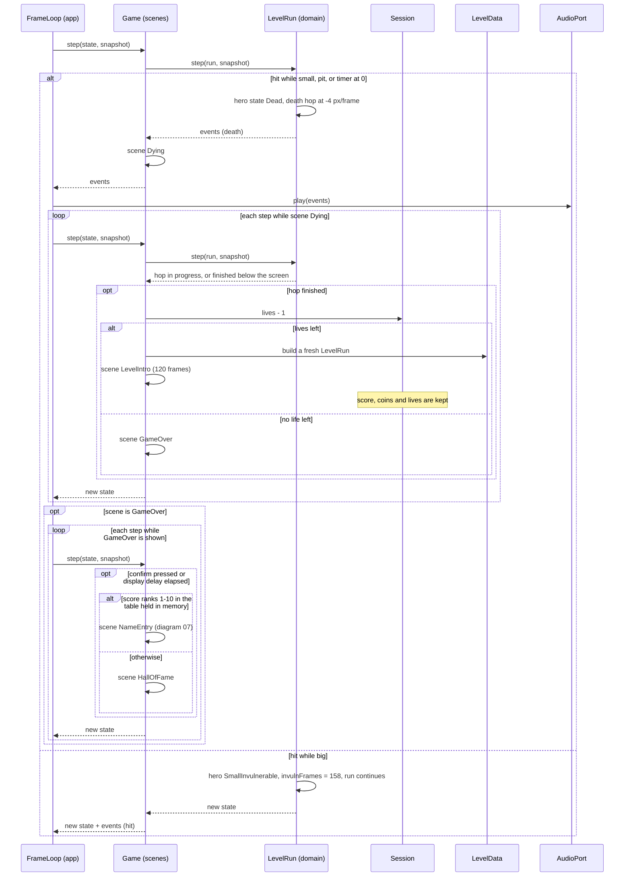

# Sequence diagram — gameplay — death, retry or game over (UC1)

> **Source specs**: [GDD](../../../design/game-design-document.md) §4.3, §8, §9; [use-case specs](../../use-case-specifications.md) UC1 extensions 4a, 4b, 4b1, 4b2
> **Related ADRs**: ADR-0005, ADR-0006

## Context

How a death leads either to a fresh attempt with the session kept, or to the end of the game and
the name entry of [07](../meta/07-sequence-name-entry.md).

## Diagram

## Notes

- Tags. Death causes and the −4 px/frame hop: **[src]** (GDD §4.3). 158 frames of
  invulnerability: **[int]** (GDD §13, Q1). 3 lives and no continue: **[gen]** (GDD §13, decision V). Level intro of
  120 frames: **[gen]** (GDD §9).
- Retry builds a new `LevelRun` from the immutable `LevelData` (04), so the tile changes of the
  previous attempt (broken bricks, used blocks) are gone; the `Session` object survives.
- "Table held in memory": the app reads the hall of fame through `StoragePort` at start-up and
  hands it to the domain state **[gen]**; the domain never calls the port. The write happens in 07.
- `GameOver` stays on screen until a confirm press or a short delay; the GDD gives neither, so both are open **[gen]** points to fix at the first code brick (GDD revision if the delay becomes a rule).
- The timer starts again at 400 units on the fresh run (GDD §8).
- The `Dying → GameOver` transition and the top-10 test follow 02; the exact moment the ranking
  is computed is not specified by the GDD **[gen]**.
