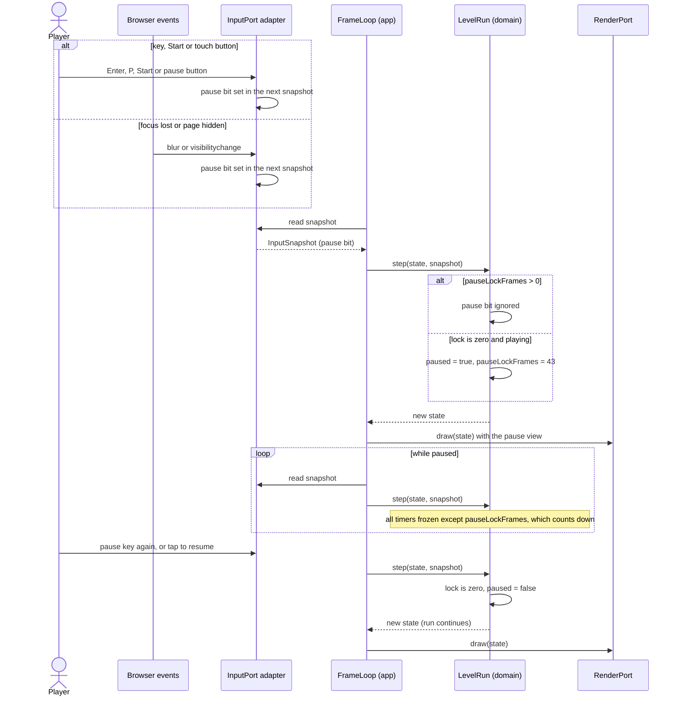

# Sequence diagram — gameplay — pause, auto-pause and resume (UC2)

> **Source specs**: [GDD](../../../design/game-design-document.md) §8, §9; [use-case specs](../../use-case-specifications.md) UC2
> **Related ADRs**: ADR-0005, ADR-0006

## Context

Detail of the pause branch drawn in short in [06](06-sequence-tick.md): who detects the trigger,
who decides, and how the 43-frame lock behaves. Pause is an input event, so a replay script
contains it.

## Diagram

## Notes

- Tags. The 43-frame lock: **[src]**. Pause keys, auto-pause on blur or hidden page, "tap to
  resume" overlay, manual resume only: **[gen]** (GDD §9, Q7).
- The adapter only turns a browser event into a bit of the snapshot; deciding what the bit means
  (toggle, ignore) is a domain rule. This keeps replays exact (ADR-0005).
- An auto-pause while already paused changes nothing; resuming is never automatic (UC2 1a).
- A trigger inside the lock is ignored (UC2 2a); because the lock keeps counting during pause,
  the first resume press after a pause is accepted once it reaches zero.
- Esc opens the menu rather than pausing; where options are reached is OQ2 and is not drawn.
