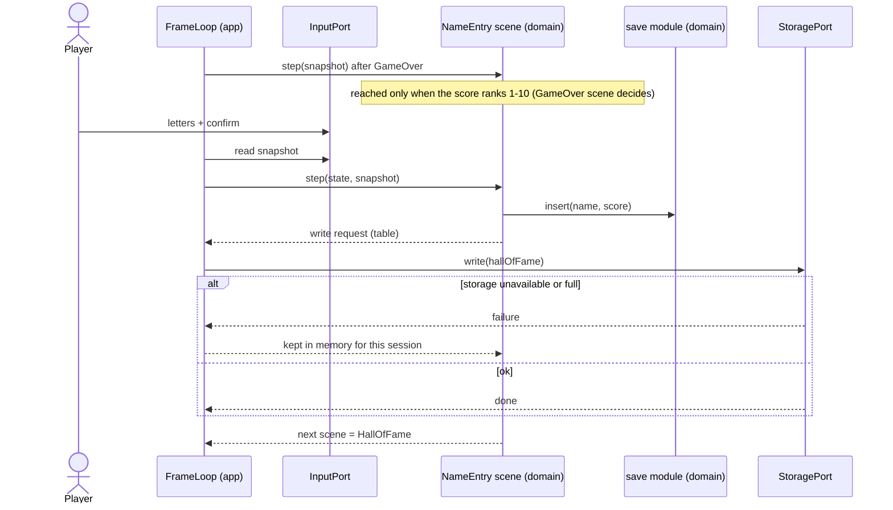

# Sequence diagram — meta — name entry in the hall of fame (UC3)

> **Source specs**: [GDD](../../../design/game-design-document.md) §9; [use-case specs](../../use-case-specifications.md) UC3, UC4
> **Related ADRs**: ADR-0006

## Context

From the game-over scene to the saved top 10, through the storage port.

## Diagram

## Notes

- Name length and charset are not yet specified in the GDD (open point, own PR) [gen]; a name is not translated.
- The domain never calls the port: the app performs the write (ADR-0006).
- Storage failure never blocks the flow: the table lives in memory until the page closes.
