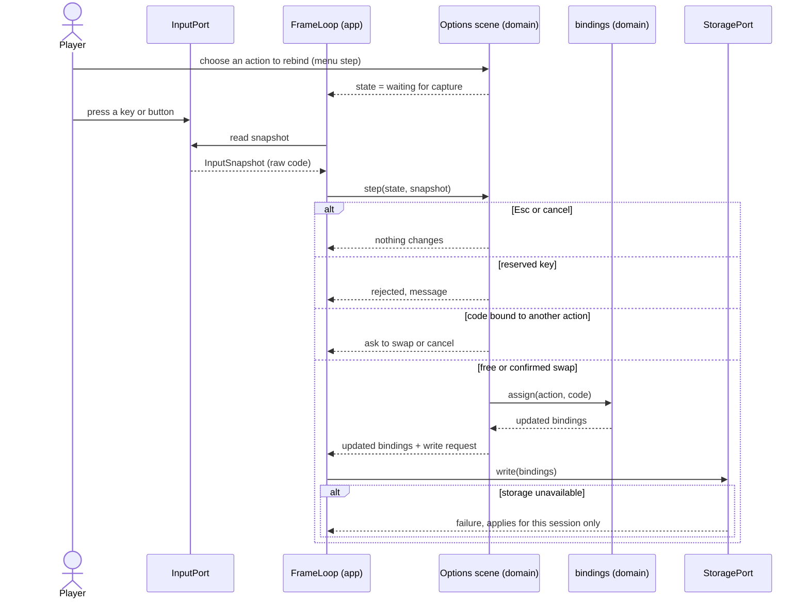

# Sequence diagram — meta — rebind a control (UC5)

> **Source specs**: [GDD](../../../design/game-design-document.md) §9, §12; [use-case specs](../../use-case-specifications.md) UC5
> **Related ADRs**: ADR-0006

## Context

Rebinding a keyboard or gamepad action from the options screen.

## Diagram

## Notes

- Only keyboard and gamepad are rebindable; touch keeps its fixed pad (GDD §9).
- The domain never reads the port: the app passes the raw code inside the snapshot and performs
  the write (ADR-0006). Menu navigation is omitted for brevity.
- Reserved keys (pause, Esc) cannot be bound to a gameplay action [gen].
