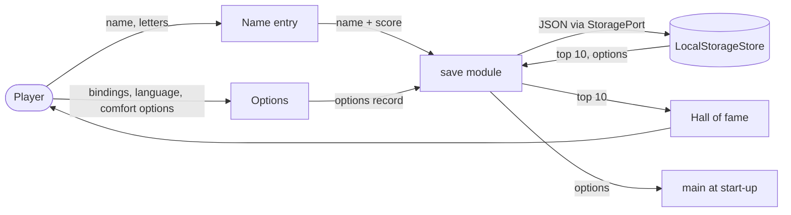

# Data-flow diagram — meta — local persistence

> **Source specs**: [GDD](../../../design/game-design-document.md) §9, §12; [use-case specs](../../use-case-specifications.md) UC3–UC6
> **Related ADRs**: ADR-0001, ADR-0006

## Context

Which data leaves the domain, where it is stored and who can read it. Nothing leaves the device
(no backend, no network call in 1.0).

## Diagram

## Notes

- Personal data: only the free-text name (up to a few letters), kept in the player's own browser;
  never sent anywhere. The score table and options are not sensitive.
- A missing or corrupt record is replaced by defaults, never by a crash.
- Reads are validated on load (type and range) before reaching the domain [gen].
