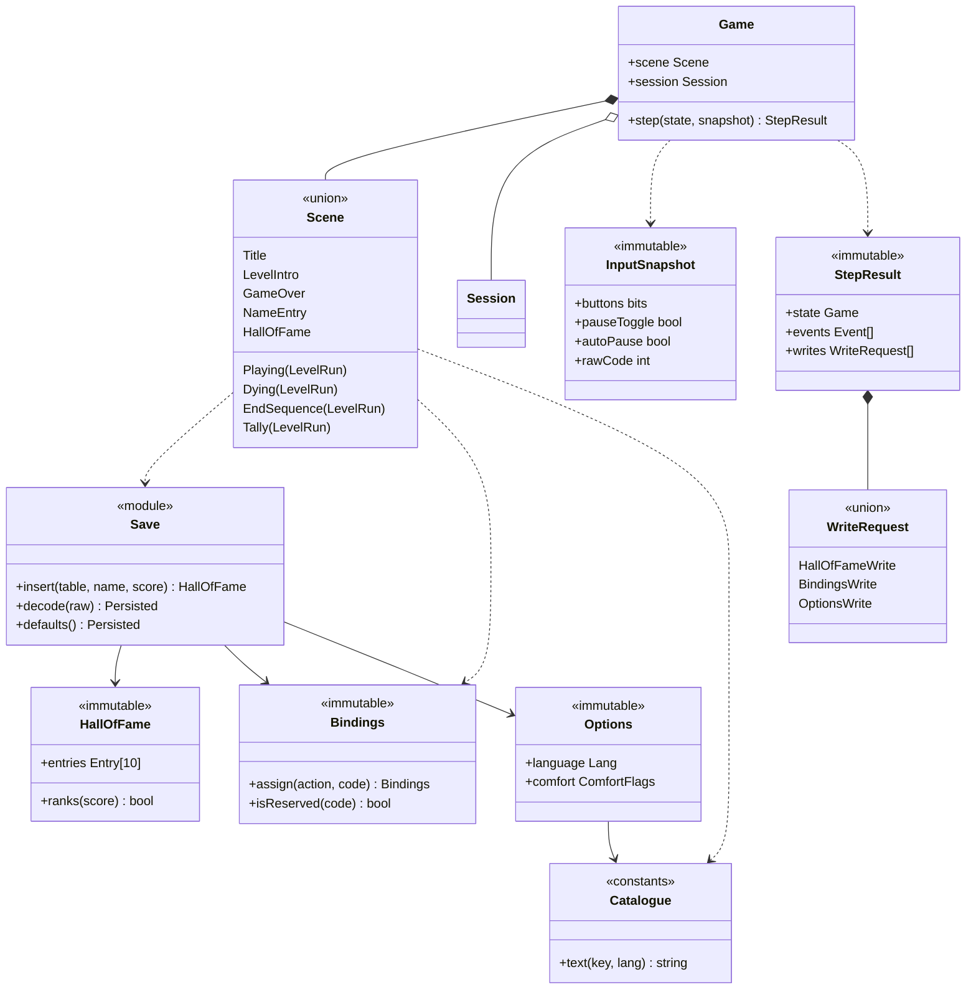

# Class diagram — meta — scenes, save, bindings, catalogue

> **Source specs**: [GDD](../../../design/game-design-document.md) §9, §12; [use-case specs](../../use-case-specifications.md) UC3–UC6
> **Related ADRs**: ADR-0005, ADR-0006

## Context

The domain types around the level run: scenes, the pure `save`, `bindings` and `i18n` modules,
and the data crossing the app boundary. Closes gap G1 of the traceability matrix. The gameplay
types are in [04](../gameplay/04-class-domain.md).

## Diagram

## Notes

- `Persisted` is the record `{hallOfFame, bindings, options}` that the app reads through `StoragePort` at start-up and hands to `Game`; `Save.decode` validates type and range and falls back to `defaults()` [gen] ([09](09-data-flow-persistence.md)).
- `StepResult.writes` is how the domain asks for I/O without calling a port: the app performs the write ([07](07-sequence-name-entry.md), [08](08-sequence-rebind.md)).
- `InputSnapshot` carries the two pause bits of [14](../gameplay/14-sequence-pause-resume.md) and the raw code used for rebinding.
- `Playing`, `Dying`, `EndSequence` and `Tally` carry the active `LevelRun` (12 and 13 keep stepping it; the tally reads its timer).
- Pause is a flag of `LevelRun` (04), not a scene, as in [02](../system/02-state-game-flow.md).
- The options screen is not a scene yet: where it is reached is OQ2 (GDD revision, own PR).
- Field names are indicative until the first code brick [gen].
