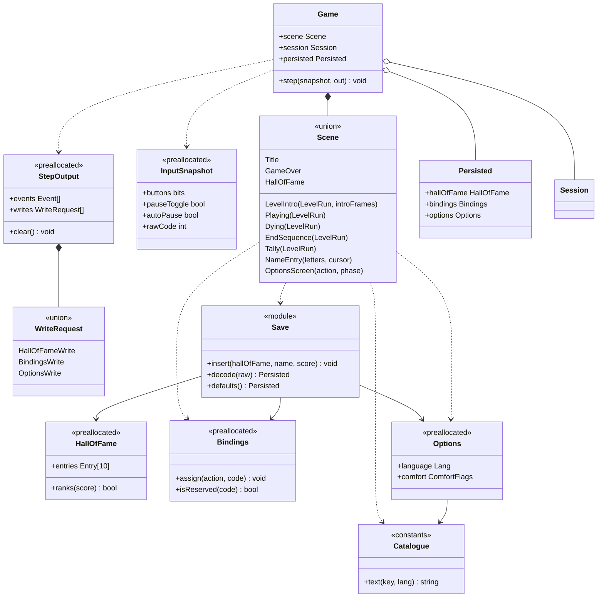

# Class diagram — meta — scenes, save, bindings, catalogue

> **Source specs**: [GDD](../../../design/game-design-document.md) §9, §12; [use-case specs](../../use-case-specifications.md) UC3–UC6
> **Related ADRs**: ADR-0005, ADR-0006

## Context

The domain types around the level run: scenes, the pure `save`, `bindings` and `i18n` modules,
and the data crossing the app boundary. Closes gap G1 of the traceability matrix. The gameplay
types are in [04](../gameplay/04-class-domain.md).

## Diagram

## Notes

- `Persisted` is the record held by `Game` (`{hallOfFame, bindings, options}`): the app reads through `StoragePort` at start-up and hands to `Game`; `Save.decode` validates type and range and falls back to `defaults()` [gen] ([09](09-data-flow-persistence.md)).
- Sequences [06](../gameplay/06-sequence-tick.md) to [14](../gameplay/14-sequence-pause-resume.md) write `step(state, snapshot)` and "new state" as shorthand: `state` is the `Game` the app owns, updated in place, and "new state" is that same object after the step; the contract here (`step(snapshot, out)`) is the precise form, and those diagrams are not rewritten for it.
- `NameEntry` keeps the letters typed and the cursor (07); `OptionsScreen` keeps the selected action and its phase (waiting for capture, swap to confirm) (08).
- `Game.step` updates the state in place (ADR-0005) and fills the preallocated `StepOutput` that the app clears each step: no per-step allocation (GDD no-allocation rule). `StepOutput.writes` is how the domain asks for I/O without calling a port: the app performs the write ([07](07-sequence-name-entry.md), [08](08-sequence-rebind.md)).
- `InputSnapshot` is one reused buffer filled in place by the input adapter each read (no allocation); it carries the two pause bits of [14](../gameplay/14-sequence-pause-resume.md) and the raw code used for rebinding.
- `Save.insert` mutates the owned `HallOfFame` in place (07); `HallOfFame`, `Bindings` and `Options` are fixed-size records updated in place inside `Game.step` (no allocation in the loop); `Save.decode` builds them once at start-up.
- `LevelIntro` holds the fresh run built on retry (13) and the frames left of its 120-frame intro (02); `Playing`, `Dying`, `EndSequence` and `Tally` carry the active `LevelRun` (12 and 13 keep stepping it; the tally reads its timer).
- Pause is a flag of `LevelRun` (04), not a scene, as in [02](../system/02-state-game-flow.md).
- `OptionsScreen` is the scene of 08 (UC5, UC6); how it is reached is OQ2 (GDD revision, own PR), so no transition into it is drawn in [02](../system/02-state-game-flow.md).
- Field names are indicative until the first code brick [gen].
