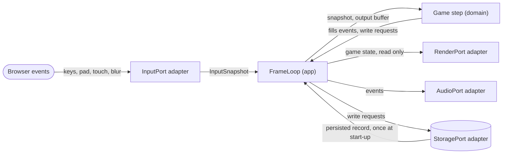

# Data-flow diagram — meta — data crossing the ports in one frame

> **Source specs**: [GDD](../../../design/game-design-document.md) §5, §9; [06](../gameplay/06-sequence-tick.md)
> **Related ADRs**: ADR-0005, ADR-0006

## Context

Which data moves between the browser, the adapters, the app and the pure domain during a frame.
Complements the persistence flow [09](09-data-flow-persistence.md). Nothing leaves the device.

## Diagram

## Notes

- `Game` owns its state and updates it in place; the app hands it the snapshot and the preallocated output buffer and reads back only the filled events and write requests (ADR-0005, no allocation in the loop). The domain receives and returns plain data only; every arrow to an adapter starts in the app.
- The persisted record enters the state once at start-up, never during the loop [gen].
- Events are transient (not stored); only write requests reach storage.
