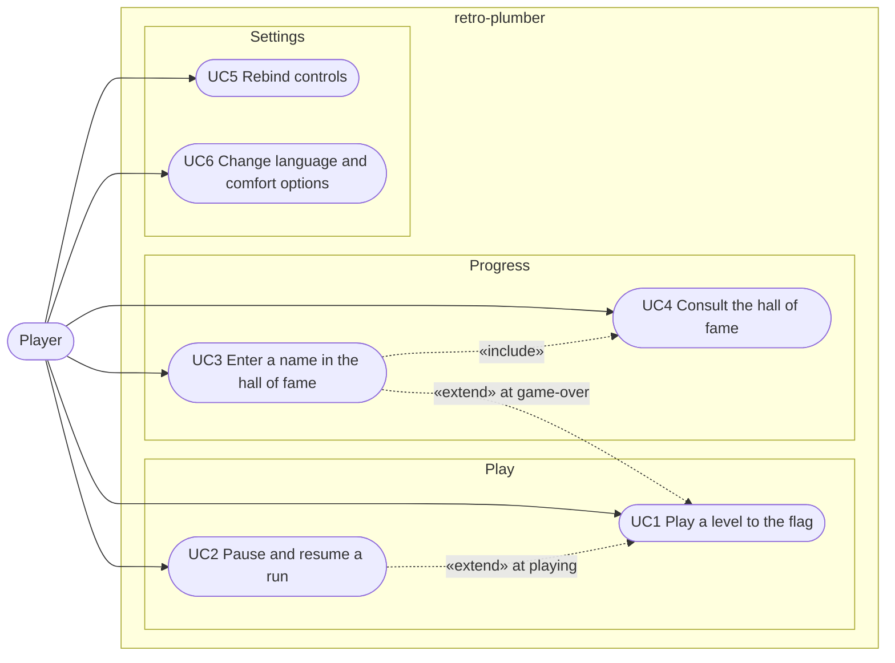

# Use case diagram — system — what the player wants

> **Source specs**: [GDD](../../../design/game-design-document.md) §1, §9, §10
> **Related ADRs**: ADR-0004, ADR-0005

## Context

Who interacts with retro-plumber and to reach which goals. Grouped by domain (Play, Progress,
Settings). It does not show how the system is built (see `03-component.md`).

## Diagram

## Notes

- UC1 main success scenario: start from the title, play the level, touch the flag, see the tally
  (GDD §9). Extensions: lose a life (pit, enemy, timer) → level intro again; no life left → game
  over → UC3 if the score is in the top 10.
- UC3 «extend» UC1 at the game-over point (only when the score qualifies).
- Comfort options (UC6): reduced flash, screen shake toggle (GDD §12).
