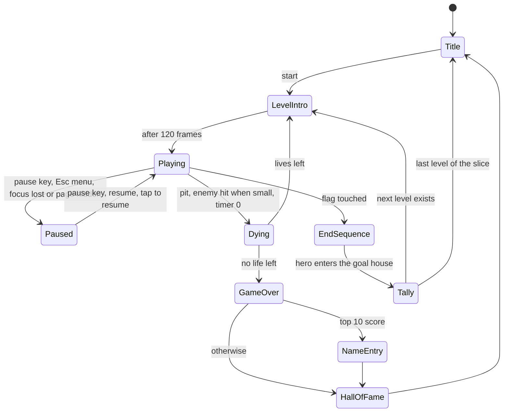

# State machine diagram — system — game flow

> **Source specs**: [GDD](../../../design/game-design-document.md) §9
> **Related ADRs**: ADR-0005

## Context

The scenes of a session, from the title to the hall of fame. The hero's own states are in
`../gameplay/05-state-hero.md`.

## Diagram

## Notes

- `EndSequence` runs the hero states FlagSlide then AutoWalk (see `../gameplay/05-state-hero.md`) with input locked; the timer is frozen until the tally.

- One scene active at a time; each scene is a domain object driven by `step(state, input)`
  (ADR-0005), rendered through `RenderPort`.
- The slice has one level, so `Tally` always goes back to `Title` until more levels exist.
