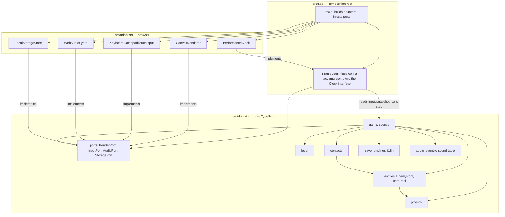

# Component diagram — system — Clean layers and ports

> **Source specs**: [CLAUDE.md](../../../../CLAUDE.md) § Architecture
> **Related ADRs**: ADR-0001, ADR-0006

## Context

The structural boundaries: the pure domain, the ports it declares, the browser adapters and the
composition root. Dependencies point inward only.

## Diagram

## Notes

- Dependencies: `app → {adapters, domain}`, `adapters → domain`, `domain → ∅` (ADR-0006).
  The `Clock` adapter implements an interface owned by `src/app/` (its only user), so it is not
  a domain port.
- Enforced by `tsconfig.domain.json` (no DOM lib) and an ESLint import boundary that also forbids
  `adapters → app` and adapter → adapter.
- Each port is small and client-specific (ISP); tests replace them with fakes (ADR-0005).
- The app reads `InputPort` and passes an input snapshot to `step`; the domain never reads input
  or the clock itself.
- `contacts` (hero vs enemies and items) and the two pools are drawn since sequences [10](../gameplay/10-sequence-collisions.md) and [11](../gameplay/11-sequence-item-pickup.md) call them (matrix decision D4).
- `save`, `bindings`, `i18n` and `audio` are pure domain modules: they transform data and return write requests or events, the app performs the I/O through the ports ([07](../meta/07-sequence-name-entry.md), [08](../meta/08-sequence-rebind.md)). Their types are in [15](../meta/15-class-meta.md).
