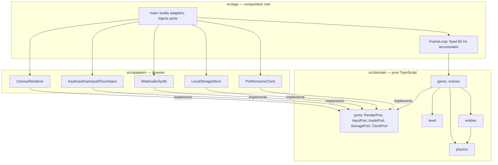

# Component diagram — system — Clean layers and ports

> **Source specs**: [CLAUDE.md](../../../../CLAUDE.md) § Architecture
> **Related ADRs**: ADR-0001, ADR-0006

## Context

The structural boundaries: the pure domain, the ports it declares, the browser adapters and the
composition root. Dependencies point inward only.

## Diagram

## Notes

- No arrow from `Domain` to `Adapters` or `App`: enforced by `tsconfig.domain.json` (no DOM lib)
  and an ESLint import boundary (ADR-0006).
- Each port is small and client-specific (ISP); tests replace them with fakes (ADR-0005).
- The game reads input as a snapshot per step; it never calls the clock directly.
